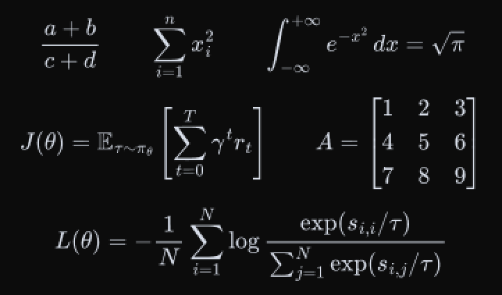
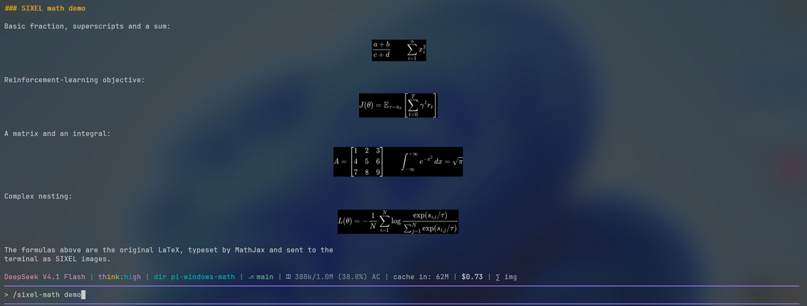

# How it works

```
LaTeX  →  MathJax  →  SVG  →  resvg  →  RGBA  →  SIXEL  →  Windows Terminal
```

Everything happens in-process. No browser, no child process, no network access,
no TeX installation.

## 1. Why SIXEL

Pi's TUI renders inline images through the Kitty (`\x1b_G`) and iTerm2
(`\x1b]1337;File=`) protocols only. Windows Terminal implements neither — it
implements SIXEL. `pi-tui`'s capability probe therefore reports `images: null`
there, which is why existing image-based math extensions silently do nothing on
Windows Terminal.

SIXEL is a bitmap format, so a formula can be drawn exactly as MathJax typeset
it, including fractions, radicals, matrices and nested structures.

## 2. Typesetting and sizing

`src/renderer/latex.ts` asks MathJax for the formula as SVG and reads the natural
size of the result in `ex` units. One `ex` is roughly half a character cell, so
sizing in `ex` keeps formulas the same visual size as the surrounding terminal
text regardless of font or DPI.

`src/renderer/math-image.ts` then maps that size onto the terminal's grid.
Windows Terminal maps SIXEL pixels onto a fixed **10 × 20 virtual pixels per
cell** grid, so an image of `W × H` virtual pixels occupies `ceil(W / 10)` columns
and `ceil(H / 20)` rows. Heights are snapped to whole SIXEL bands (6 px each) so
the row arithmetic stays exact; formulas wider than the transcript are scaled
down proportionally (never re-wrapped).

## 3. Rasterizing

`src/renderer/raster.ts` renders the SVG with resvg at 4× and box-filters it down,
which gives anti-aliased edges instead of jagged ones. The result is composited
over the configured terminal background. `npm run preview` writes exactly the
pixels that are sent to the terminal:



System fonts are deliberately **not** loaded: MathJax emits glyph outlines, and
enumerating the Windows font directory costs ~150 ms per call — about 15× the cost
of the rest of the pipeline. Formulas that contain non-ASCII text (for example
`\text{中文}`) do need a real font, so those alone opt into the font database.

## 4. Encoding

`src/renderer/sixel.ts` quantizes the image with median cut (≤ 256 colors, 24 by
default — enough for a single-color formula with anti-aliasing) and encodes it
with run-length encoding. Pixels equal to the background are emitted as
*unpainted* rather than as a color: this shrinks the payload dramatically and lets
the terminal's own background show through, so the image blends into the
transcript instead of forming a visible rectangle.

## 5. Getting it into the transcript

`src/tui/math-markdown-patch.ts` wraps `Markdown.prototype.render` from
`@earendil-works/pi-tui`. Because extensions resolve that module to the *host's*
instance, this patches the renderer Pi is actually using — without modifying any
installed file.

For the duration of one render call the document text is swapped for a copy whose
formulas are markers; Pi's own Markdown renderer then runs unchanged. Marker
lines are replaced afterwards with SIXEL lines, and the component text is restored
before `render()` returns. The session file and the model context therefore always
contain the original LaTeX.

Formulas inside fenced code blocks, indented code, inline code or after an escaped
`\$` are never touched. A formula that cannot be typeset is left as-is, which
means Pi's built-in Unicode math rendering takes over.

## 6. Why the image line looks the way it does

Pi's differential renderer already knows how to reserve space for multi-row
images — for Kitty. The SIXEL line reuses exactly that machinery:

```
<padding><SIXEL DCS><cursor-up><\x1b_Gi=<id>,r=<rows>;q\x1b\\>
```

* the trailing kitty header makes `isImageLine()` true, so the renderer neither
  measures nor wraps the payload, and its `r=<rows>` parameter makes
  `getKittyImageReservedRows()` reserve the right number of rows,
* the renderer consequently pre-scrolls `rows - 1` lines *before* drawing, which
  guarantees the image fits on screen and never scrolls the terminal behind the
  TUI's back,
* the reserved rows carry a zero-visible-width marker whose value is derived from
  the image payload, so a redraw always rewrites the whole block instead of
  leaving stale pixels (Windows Terminal erases image pixels when a cell is
  rewritten, so a partial rewrite would cut the formula apart),
* the trailing cursor-up compensates for Windows Terminal leaving the text cursor
  on the cell intersected by the top of the last SIXEL band.

All of this was measured on real Windows Terminal rather than assumed:
`npm run probe` reports the cursor advance for several image heights, verifies
the cursor restore, checks that the `\x1b_G` marker is harmless, and reads the
terminal's background color via OSC 10/11.

## 7. Transparent image backgrounds

The DCS introducer selects `P2 = 1` (`\x1bP0;1;0q`), the DEC "background
transparent" setting. Windows Terminal inspects exactly this parameter to decide
whether it fills the image rectangle with the current background color, so
`P2 = 0` paints a black box around every formula:



Unpainted pixels stay transparent (the terminal's image slice keeps alpha 0),
which is what lets wallpapers, acrylic and light themes show through. The encoder
also drops every pixel that matches the background color, so most of a formula's
bounding box is never transmitted at all.
